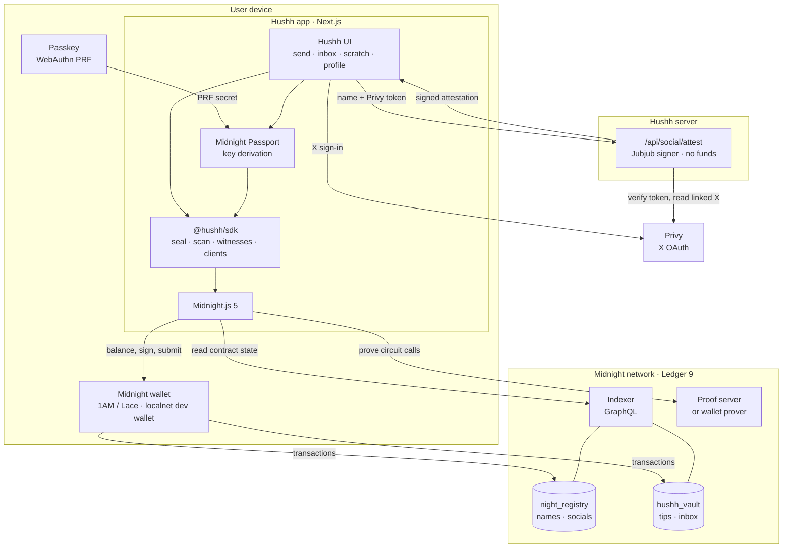
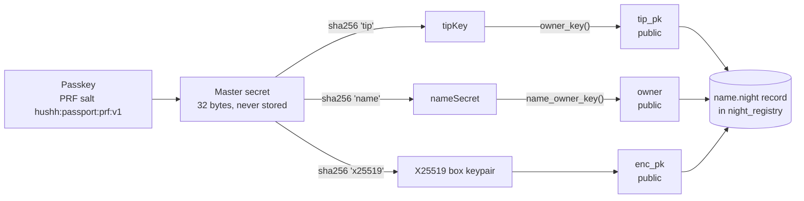
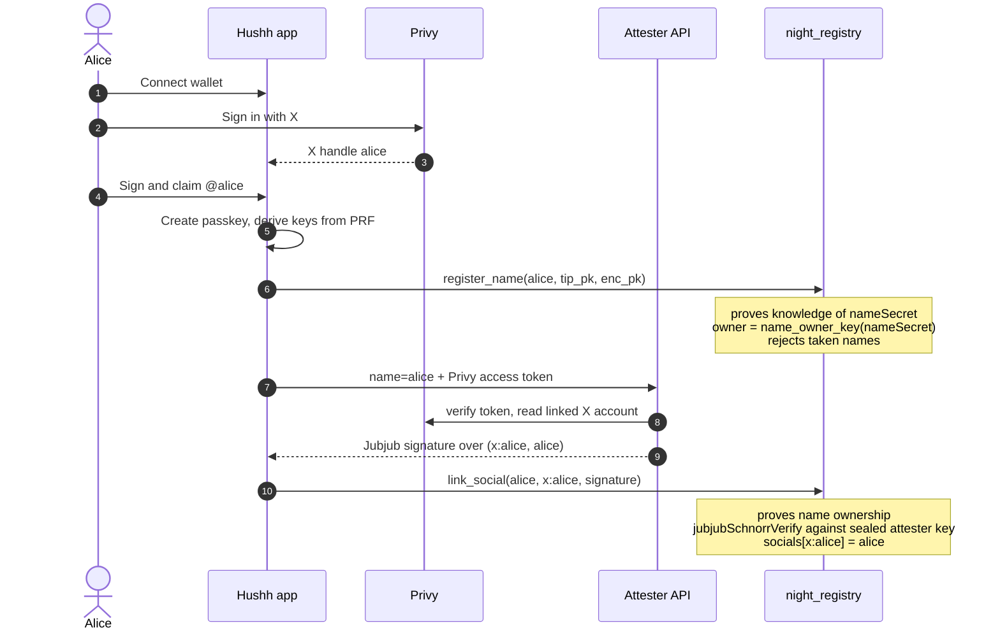
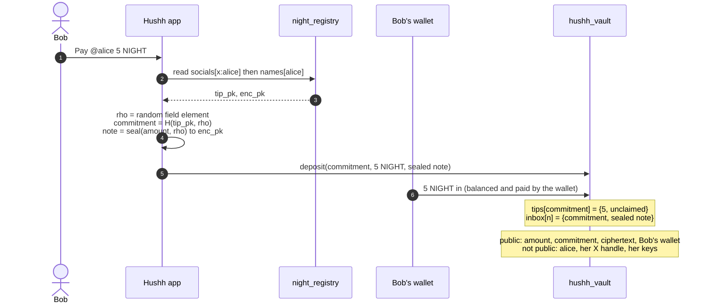
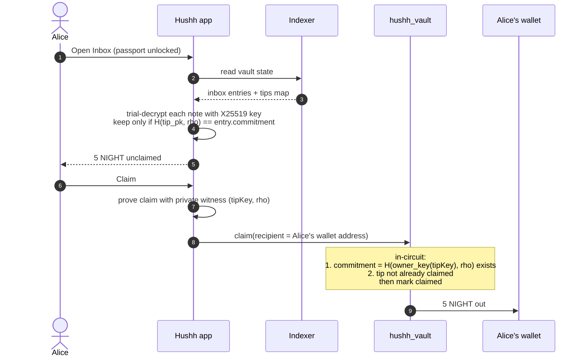
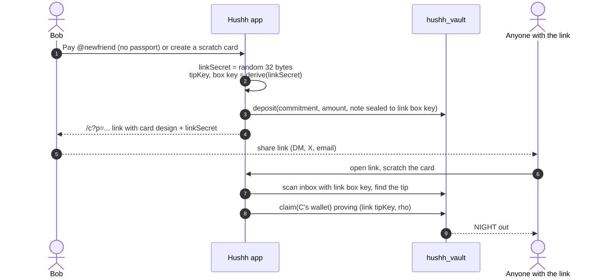
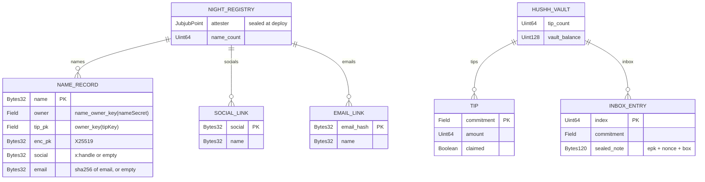
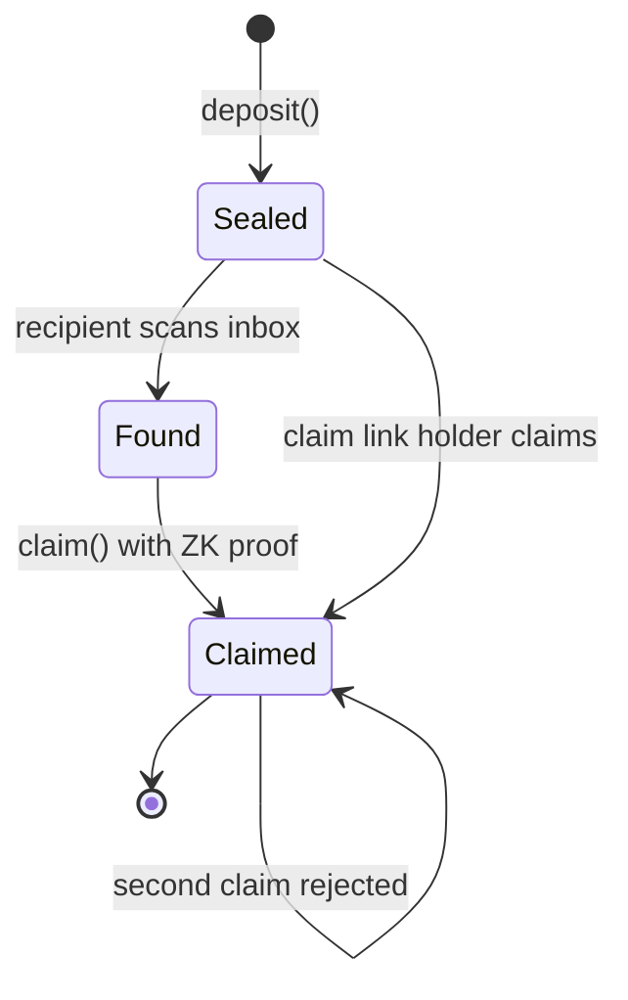

# Hushh Protocol on Midnight

Own your `.night` name with **Midnight Passport**, link your X handle to it, and get paid in NIGHT. Tips are sealed to the recipient's passport and claimed with a zero-knowledge proof that Midnight verifies natively.

Tagline: send silently.

**Live app:** https://midnight-hushh.vercel.app · **X:** [@hushhprotocol](https://x.com/hushhprotocol)

> Prototype. Contracts are unaudited and target the local devnet and Midnight test networks. Do not use with real value.

---

## What it does

| Step | What happens | Where |
|------|--------------|-------|
| **Claim a passport** | A passkey (WebAuthn PRF) derives your keys. Your X handle becomes `<handle>.night`. No seed phrase. | `night_registry.register_name` |
| **Link X** | The app signs you in with X (Privy). A server attester Jubjub-signs "x:handle belongs to name.night"; the contract checks the signature in-circuit. | `night_registry.link_social` |
| **Link email** | Privy verifies the email with a one-time code; the attester signs "email belongs to name.night". Only a SHA-256 hash of the email goes on-chain, next to the X handle. | `night_registry.link_email` |
| **Send** | Pay `alice.night` or `@alice`. The app reads her passport keys from the registry, seals the tip to her X25519 key, and deposits NIGHT in one transaction. | `hushh_vault.deposit` |
| **Inbox** | Alice finds her tips by trial-decrypting the vault's on-chain inbox with her passport key. No backend inbox. | client-side scan |
| **Claim** | A Compact circuit proves she knows the tip's secret and it was never claimed. NIGHT goes to her wallet. | `hushh_vault.claim` |
| **Claim links / scratch cards** | Pay someone who has no passport yet: the link carries a one-time secret. Scratch cards add a design to the same tip. | `deposit` + `claim` |

## Privacy, stated plainly

**Private**
- Passport secrets never leave the device; the chain stores only hashes of your keys.
- A payment never names the recipient. Their name, X handle and keys are not in the tip.
- A tip sent to a passport is bound to the recipient's key: the sender cannot claim it back.
- No server learns who got paid.

**Not private**
- Tips are unshielded NIGHT: sender wallet, amount and receiving wallet are public.
- Claims are checked against a plain map of commitments, so a claim reveals which deposit it spent. An observer can link the paying wallet to the claiming wallet. (A Merkle-tree claim would hide this; not in this build.)
- Names, payment keys and linked X handles are public by design, so people can pay you.
- Claim links are bearer secrets.

## Architecture

### System overview



Nothing secret leaves the device: the passkey secret, tip key and note secrets are only ever used as private witnesses inside proofs. The server only signs "this X handle belongs to this .night name" after checking the X login.

### Midnight Passport: one passkey, three keys



The public halves go into the `.night` record so anyone can pay you. The secret halves are re-derived from the passkey at every sign-in (a passphrase is the fallback where PRF is unavailable).

### Flow 1: claim a passport and link X



### Flow 2: send a tip to `@alice`



If `@alice` has no passport yet, the same deposit is made to a one-time key and Bob gets a claim link instead (Flow 4).

### Flow 3: inbox scan and zero-knowledge claim



The sender knows `rho` but not Alice's `tipKey`, so the sender cannot claim the tip back.

### Flow 4: claim links and scratch cards



Scratch cards sent to an existing passport carry only the tip's commitment in the link (no secret): only that passport can claim them.

### On-chain state



### Tip lifecycle



### What each circuit enforces

| Circuit | Private witness | Checks | Public effect |
|---------|-----------------|--------|---------------|
| `register_name` | `nameSecret` | name not empty, not taken | new `.night` record |
| `update_keys` | `nameSecret` | caller owns the name | rotate `tip_pk` / `enc_pk` |
| `link_social` | `nameSecret` | owns the name; Jubjub signature from the sealed attester over `(social, name)` | `socials[x:handle] = name`, previous holder unlinked |
| `unlink_social` | `nameSecret` | owns the name, has a link | link removed |
| `link_email` | `nameSecret` | owns the name; attester signature over `(email_hash, name)` with its own tag, so an X attestation cannot be replayed | `emails[sha256(email)] = name`, previous holder unlinked; X link untouched |
| `unlink_email` | `nameSecret` | owns the name, has an email | email link removed |
| `deposit` | none | amount > 0, commitment unused | NIGHT in, tip + inbox entry stored |
| `claim` | `tipKey`, `rho` | commitment for `owner_key(tipKey), rho` exists; not claimed | tip marked claimed, NIGHT to recipient wallet |

| Contract | Circuits | Largest prover key |
|----------|----------|--------------------|
| `night_registry` | `register_name`, `update_keys`, `link_social`, `unlink_social`, `link_email`, `unlink_email` | 4.2 MB (`link_social` / `link_email`, Jubjub Schnorr) |
| `hushh_vault` | `deposit`, `claim` | 0.9 MB |

## Repo layout

```
midnight/                Compact contracts, shared SDK, tests, localnet
  contracts/             hushh_vault.compact, night_registry.compact
  src/sdk/               keys, notes (seal/scan), attestation, witnesses, clients
  src/node/              deploy + end-to-end script (real proofs on localnet)
  test/                  simulator tests (vitest)
  infra/                 Docker compose: node 2.1.101, indexer 4.4.101, proof server 9.0.2
frontend/                Next.js 15 app (UI unchanged, Midnight data layer)
  src/lib/midnight/      config, wallet backends, passkey, passport, store, hooks
  src/app/api/social/attest/route.ts   X + email attester
```

## Run it locally

Requirements: Node 22+, pnpm, Docker, Compact toolchain 0.36.1 (`compact update 0.36.1`).

```bash
# 1. contracts + localnet
cd midnight
npm install
npm run compile          # compact 0.36.1, language 0.28.0
npm test                 # 19 simulator tests
npm run localnet:up      # node + indexer + proof server
npm run deploy           # writes deployments/local.json and .secrets/attester-local.json
npm run test:e2e         # register, link X, tip, claim, claim link — real proofs

# 2. app
cd ../frontend
pnpm install
cp .env.example .env.local   # localnet: add ATTESTER_DEV_MODE=1 if you have no Privy app
pnpm dev                     # http://localhost:3000 (use localhost, not 127.0.0.1, for passkeys)
```

On localnet the app runs the genesis wallet inside the page and pays all fees, so you need no wallet extension. Add `?passport=passphrase` to use a passphrase instead of a passkey (browsers without WebAuthn PRF, automated tests).

## Preprod (not done yet)

The frontend's connector mode is written for preview/preprod, but nothing has been deployed or tested there.

1. Deploy: `midnight/src/node/wallet.ts` only has a localnet config today. Add a preprod entry (Blockfrost indexer + node with a `project_id`, a proof server) and deploy from a wallet holding tNIGHT and DUST, or deploy from the browser through 1AM.
2. Set `NEXT_PUBLIC_MIDNIGHT_NETWORK=preprod` and the contract addresses (or a `deployments/preprod.json`).
3. Users connect 1AM or Lace; the wallet proves and pays DUST.
4. Set `NEXT_PUBLIC_PRIVY_APP_ID`, `PRIVY_APP_SECRET`, `ATTESTER_SECRET` (the key the registry was deployed with). Never set `ATTESTER_DEV_MODE` outside localnet.

## Toolchain

Ledger 9.1 set: `compact` 0.36.1 · `compact-runtime` 0.21.0 · `midnight-js` 5.0.2 · `ledger-v9` 1.0.2 · Wallet SDK 2.0.1 · DApp Connector 4.1.0.
# midnight-hushhprotocol
